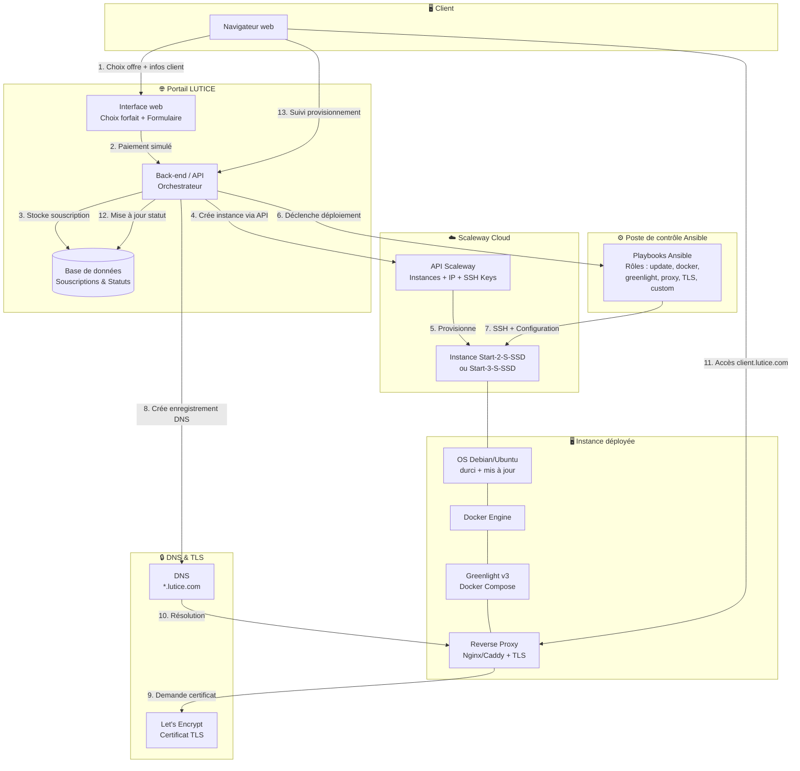

<h1 align="center">
  
  <br />
  Hackathon 2026<br>
  <sub><em><h6>by STS CNAM 2026</h6></em></sub>
</h1>

# Cahier des Charges Technique — Projet LUTICE

**Version** : 1.0  
**Date** : 10 février 2026  
**Commanditaire** : Fabrice Lenoble - [fabrice.lenoble@geezot.com](mailto:fabrice.lenoble@geezot.com "mailto:fabrice.lenoble@geezot.com") - LUTICE ([www.lutice.com](https://www.lutice.com/))  
**Destinataires** : Équipes étudiantes de Licence 3 STS Informatique  
**Classification** : Document projet — Hackathon 5 jours

---

## Table des matières

1. [Résumé exécutif](#1-résumé-exécutif)
2. [Périmètre](#2-périmètre)
3. [Parties prenantes & rôles équipe hackathon](#3-parties-prenantes--rôles-équipe-hackathon)
4. [Architecture cible (vue d'ensemble)](#4-architecture-cible-vue-densemble)
5. [Exigences fonctionnelles](#5-exigences-fonctionnelles)
6. [Exigences non fonctionnelles](#6-exigences-non-fonctionnelles)
7. [Spécifications techniques détaillées](#7-spécifications-techniques-détaillées)
8. [Données & paramètres](#8-données--paramètres)
9. [Plan de travail Hackathon (J1 → J5)](#9-plan-de-travail-hackathon-j1--j5)
10. [Livrables attendus](#10-livrables-attendus)
11. [Jeux de tests / scénarios de validation](#12-jeux-de-tests--scénarios-de-validation)
12. [Risques & limites](#13-risques--limites)
13. [Annexes](#14-annexes)

---

## 1. Résumé exécutif

### Objectif

Le projet LUTICE vise à concevoir et développer une plateforme complète permettant le **déploiement automatisé du service Greenlight** ([BigBlueButton](https://bigbluebutton.org/)) sur des instances dédiées hébergées chez [Scaleway](https://www.scaleway.com). Le processus couvre l'intégralité de la chaîne : choix d'un forfait par le client, paiement, provisionnement automatique de l'infrastructure, configuration système, déploiement applicatif et personnalisation — le tout sans intervention humaine après validation du paiement.

### Valeur métier

LUTICE est un hébergeur français spécialisé dans l'intégration de BigBlueButton pour les établissements d'enseignement et les entreprises. Ce projet industrialise le processus d'onboarding client, transformant une opération manuelle de plusieurs heures en un déploiement automatisé de bout en bout. Le client obtient son instance Greenlight personnalisée, accessible via un sous-domaine dédié (ex : `lerebours.lutice.com`), quelques minutes après sa souscription.

### Livrable final attendu

À l'issue du hackathon de 5 jours, chaque équipe livrera une **plateforme fonctionnelle** composée de :

- Un **portail web** permettant le choix d'offre, la saisie des informations client et la simulation de paiement
- Un **orchestrateur back-end** déclenchant le provisionnement via l'API Scaleway
- Un ensemble de **playbooks Ansible** assurant la configuration système et le déploiement de Greenlight via Docker
- Une **démonstration complète** du flux de bout en bout lors de la soutenance J5 après-midi

---

## 2. Périmètre

### 2.1 Inclus

- Portail web de souscription (choix forfait, formulaire client, paiement simulé)
- Appels à l'API Scaleway pour le provisionnement d'instances (création, association IP, déploiement clé SSH)
- Configuration système automatisée via Ansible (mises à jour, durcissement minimal, installation Docker)
- Déploiement de Greenlight v3 conteneurisé via Docker Compose, piloté par Ansible
- Configuration d'un reverse proxy avec terminaison TLS (Let's Encrypt ou alternative)
- Personnalisation de l'instance Greenlight (nom, logo, couleurs) à partir des paramètres client
- Création automatique de deux comptes Greenlight : un compte utilisateur client (non-admin) et un compte administrateur rattaché à LUTICE
- Association d'un sous-domaine de la forme `<client>.lutice.com`
- Interface de suivi du statut de provisionnement (tableau de bord ou page de statut)
- Documentation technique, guide de démo et procédure d'installation

### 2.2 Exclus

- Intégration d'un vrai système de paiement (Stripe, PayPal…) — le paiement est **simulé**
- Gestion complète d'un back-office d'administration LUTICE (gestion multi-clients, facturation récurrente, résiliation)
- Mise en production réelle avec trafic utilisateurs final
- Monitoring avancé des instances déployées (Prometheus, Grafana…) — un suivi de statut simple suffit
- Sauvegarde et restauration des données Greenlight
- Haute disponibilité, load balancing ou scaling horizontal
- Tests de charge et benchmarks de performance BigBlueButton

### 2.3 Hypothèses

| #   | Hypothèse                                                                                                                                                   | Impact si invalide                                           | Alternative proposée                                                                           |
| --- | ----------------------------------------------------------------------------------------------------------------------------------------------------------- | ------------------------------------------------------------ | ---------------------------------------------------------------------------------------------- |
| H1  | Le paiement est **simulé** via un formulaire avec validation fictive (bouton « Payer » sans transaction réelle)                                             | Aucun — c'est la cible                                       | Optionnel : intégration Stripe en mode test                                                    |
| H2  | Un domaine `lutice.com` (ou sous-domaine de test) est disponible et le DNS est **modifiable** par l'équipe ou pré-configuré avec un wildcard `*.lutice.com` | Impossibilité de générer un certificat Let's Encrypt valide  | Utiliser un DNS dynamique (nip.io, sslip.io) ou un certificat auto-signé documenté avec MKcert |
| H3  | Les étudiants disposent de **tokens d'accès API Scaleway** avec des quotas suffisants pour créer des instances                                              | Blocage complet du provisionnement                           | Travailler avec un compte Scaleway mutualisé fourni par l'enseignant ou simuler les appels API |
| H4  | Les instances Scaleway sont créées dans la **région fr-par** (Paris) pour la latence et la conformité                                                       | Aucun impact majeur                                          | Adapter la zone dans la configuration                                                          |
| H5  | Le **script bash fourni** par Fabrice est disponible comme ressource de référence pour le déploiement Greenlight                                            | Les étudiants devront reconstituer la logique de déploiement | S'appuyer sur la documentation officielle BigBlueButton/Greenlight                             |

---

## 3. Parties prenantes & rôles équipe hackathon

### 3.1 Parties prenantes

| Partie prenante         | Nom                                                        | Rôle                                   | Implication                                                         |
| ----------------------- | :--------------------------------------------------------- | :------------------------------------- | ------------------------------------------------------------------- |
| **LUTICE**              | Fabrice Lenoble                                            | Commanditaire, responsable du projet   | Définition du besoin J1, validation finale lors de la soutenance J5 |
| **Enseignant référent** | Patrizio Valente<br>Benoit Foujols<br>Jean François Bonnet | Encadrement pédagogique                | Suivi quotidien, arbitrage technique                                |
| **Référent technique**  | Benoit Foujols                                             | Encadrement technique                  | Accès Scaleway, Github                                              |
| **Équipes étudiantes**  | Par groupe                                                 | Conception, développement, intégration | Réalisation complète du projet sur 5 jours                          |

### 3.2 Organisation des pôles

Chaque équipe est organisée en **trois pôles**. La répartition indicative ci-dessous peut être adaptée selon la taille de l'équipe.

#### Pôle 1 — Portail / Développement web / API Scaleway

| Responsabilité | Détails |
|---------------|---------|
| Développement du portail web | Interface de choix de forfait, formulaire client, simulation de paiement |
| Intégration API Scaleway | Appels REST pour le provisionnement des instances (création, IP, clé SSH) |
| Orchestration back-end | Déclenchement du pipeline de déploiement après paiement validé |
| API / webhooks | Exposition d'un endpoint de statut pour le suivi du provisionnement |
| Base de données | Stockage des souscriptions, statuts de déploiement |

**Technologies suggérées** : Python (Django) / PHP (Symfony), HTML/CSS/JS, API REST Scaleway.

#### Pôle 2 — Système / Infrastructure

| Responsabilité               | Détails                                                                         |
| ---------------------------- | ------------------------------------------------------------------------------- |
| Architecture réseau Scaleway | Choix du type d'instance, configuration réseau, firewall (Security Groups, IAM) |
| Gestion DNS                  | Configuration des enregistrements DNS pour les sous-domaines clients            |
| Gestion TLS                  | Mise en place de Let's Encrypt (Certbot) ou alternative (MKcert)                |
| Sécurité système             | Durcissement de l'OS, gestion des clés SSH, politique de firewall, WAF          |
| Support aux autres pôles     | Conseil sur les choix d'infrastructure, débogage réseau                         |

**Technologies suggérées** : Scaleway Console/CLI, DNS (Scaleway DNS ou alternative), Certbot, Mkcert, WAF, iptables/nftables.

#### Pôle 3 — Scripting / Déploiement (IaC / Ansible / Docker)

| Responsabilité | Détails |
|---------------|---------|
| Playbooks Ansible | Écriture des rôles : mise à jour système, installation Docker, déploiement Greenlight |
| Docker Compose | Rédaction et maintenance du `docker-compose.yml` pour Greenlight |
| Personnalisation Greenlight | Configuration dynamique (nom, logo, email admin, comptes utilisateurs) |
| Inventaire Ansible | Gestion dynamique ou statique des hôtes déployés |
| Intégration continue | Lien avec le back-end pour déclencher les playbooks automatiquement |

**Technologies suggérées** : Ansible ≥ 2.14, Docker / Docker Compose, Bash, Jinja2 (templates Ansible).

### 3.3 Synchronisation inter-pôles

Les pôles interagissent via des **contrats d'interface** définis dès J1 :

- **Pôle 1 → Pôle 2** : Le portail transmet les informations de provisionnement (type d'instance, IP, domaine) au pôle infra.
- **Pôle 1 → Pôle 3** : Le back-end déclenche les playbooks Ansible avec les variables client (nom, email, domaine, forfait).
- **Pôle 2 → Pôle 3** : L'infra fournit les accès SSH et les informations réseau nécessaires à Ansible.
- **Point de synchronisation quotidien** recommandé : stand-up de 15 minutes chaque matin.

---

## 4. Architecture cible (vue d'ensemble)

### 4.1 Schéma d'architecture



### 4.2 Description des composants

| Composant                       | Rôle                                                                                                  | Technologies suggérées                                    |
| ------------------------------- | ----------------------------------------------------------------------------------------------------- | --------------------------------------------------------- |
| **Interface web**               | Page de choix de forfait, formulaire de saisie (nom, email), simulation de paiement, page de suivi    | HTML/CSS/JS                                               |
| **Back-end / Orchestrateur**    | Reçoit la souscription, orchestre le provisionnement, déclenche Ansible, expose le statut             | Python (Django), PHP (Symfony)                            |
| **Base de données**             | Stocke les souscriptions clients, les statuts de déploiement, les métadonnées d'instance              | SQLite (simple), PostgreSQL, MySQL, Mariadb               |
| **API Scaleway**                | Crée les instances, associe les IP publiques, déploie les clés SSH                                    | API REST Scaleway v2                                      |
| **Ansible (poste de contrôle)** | Pilote la configuration distante de l'instance : OS, Docker, Greenlight, proxy, TLS, personnalisation | Ansible ≥ 2.14                                            |
| **Instance Scaleway**           | Machine cible hébergeant Greenlight                                                                   | Voir pré-requis de Greenlight                             |
| **Docker / Greenlight**         | Conteneurisation de Greenlight v3 et de ses dépendances (PostgreSQL, Redis)                           | Docker Engine, Docker Compose                             |
| **Reverse Proxy + TLS**         | Terminaison HTTPS, redirection vers Greenlight                                                        | Nginx + Certbot / Caddy (TLS automatique) / WAF           |
| **DNS**                         | Résolution `<client>.lutice.com` vers l'IP de l'instance                                              | Scaleway DNS, Cloudflare ou wildcard + nip.io en fallback |

### 4.3 Flux principal de bout en bout

1. **Choix de l'offre** — Le client accède au portail LUTICE et sélectionne un forfait.
2. **Saisie des informations** — Le client renseigne son nom (qui détermine le sous-domaine) et son adresse email.
3. **Paiement simulé** — Le client valide un formulaire de paiement fictif.
4. **Provisionnement Scaleway** — Le back-end appelle l'API Scaleway pour créer une instance du type correspondant au forfait, avec une IP publique et la clé SSH LUTICE.
5. **Attente de disponibilité** — Le back-end attend que l'instance soit dans l'état `running` (polling ou webhook).
6. **Configuration Ansible** — Le back-end génère l'inventaire Ansible et déclenche le playbook principal avec les variables client.
7. **Déploiement** — Ansible se connecte en SSH à l'instance et exécute successivement : mise à jour OS → installation Docker → déploiement Greenlight (Docker Compose) → configuration reverse proxy → obtention certificat TLS → personnalisation Greenlight → création des comptes.
8. **Enregistrement DNS** — Un enregistrement A est créé pour `<client>.lutice.com` pointant vers l'IP publique de l'instance.
9. **Notification** — Le statut passe à « Prêt ». Le client peut accéder à son instance via `https://<client>.lutice.com`.

---

## 5. Exigences fonctionnelles

### 5.1 Portail web

| ID | Exigence | Priorité | Détails |
|----|----------|----------|---------|
| **F-PORT-01** | Affichage des forfaits | Obligatoire | Présentation claire des deux offres avec prix, limites utilisateurs et stockage |
| **F-PORT-02** | Formulaire de souscription | Obligatoire | Champs : nom du client, adresse email. Le nom détermine le sous-domaine (`<nom>.lutice.com`) |
| **F-PORT-03** | Validation des entrées | Obligatoire | Vérification du format email, unicité du nom de sous-domaine, caractères autorisés (alphanumériques, tirets) |
| **F-PORT-04** | Paiement simulé | Obligatoire | Formulaire fictif avec bouton de validation. Aucune transaction réelle. Un numéro de carte factice (ex : `4242 4242 4242 4242`) déclenche le succès |
| **F-PORT-05** | Page de suivi du provisionnement | Obligatoire | Affichage en temps réel (ou par polling) du statut : `En attente` → `Provisionnement` → `Configuration` → `Déploiement` → `Prêt` |
| **F-PORT-06** | Lien vers l'instance | Obligatoire | Une fois le statut « Prêt », affichage de l'URL `https://<client>.lutice.com` cliquable |
| **F-PORT-07** | Upload du logo | Souhaitée | Le client peut uploader un logo (PNG/JPG, max 2 Mo) lors de la souscription |

### 5.2 Orchestration et provisionnement

| ID | Exigence | Priorité | Détails |
|----|----------|----------|---------|
| **F-ORCH-01** | Déclenchement automatique | Obligatoire | Le provisionnement démarre automatiquement après validation du paiement simulé |
| **F-ORCH-02** | Appel API Scaleway | Obligatoire | Création d'une instance du bon type selon le forfait choisi |
| **F-ORCH-03** | Association IP publique | Obligatoire | L'instance reçoit une IP publique flexible (ou réservée) |
| **F-ORCH-04** | Déploiement clé SSH | Obligatoire | La clé SSH publique LUTICE est installée sur l'instance à la création |
| **F-ORCH-05** | Gestion des états | Obligatoire | Le back-end suit l'état du pipeline et met à jour la base de données |
| **F-ORCH-06** | Gestion des erreurs | Obligatoire | En cas d'échec à une étape, le statut est mis à jour avec un message d'erreur explicite |
| **F-ORCH-07** | Logs d'exécution | Souhaitée | Les logs du provisionnement et du déploiement sont stockés et consultables |

### 5.3 Déploiement et configuration automatisés

| ID            | Exigence                     | Priorité    | Détails                                                                                |
| ------------- | ---------------------------- | ----------- | -------------------------------------------------------------------------------------- |
| **F-DEPL-01** | Mise à jour système          | Obligatoire | `apt update && apt upgrade` automatisé via Ansible                                     |
| **F-DEPL-02** | Installation Docker          | Obligatoire | Docker Engine + Docker Compose installés via Ansible                                   |
| **F-DEPL-03** | Déploiement Greenlight v3    | Obligatoire | Greenlight déployé via Docker Compose avec PostgreSQL et Redis                         |
| **F-DEPL-04** | Reverse proxy + TLS          | Obligatoire | Nginx ou Caddy configuré comme reverse proxy avec certificat TLS valide                |
| **F-DEPL-05** | Création enregistrement DNS  | Obligatoire | Enregistrement A créé pour `<client>.lutice.com` → IP de l'instance                    |
| **F-DEPL-06** | Compte utilisateur client    | Obligatoire | Un compte Greenlight est créé avec l'email du client, rôle **utilisateur** (non-admin) |
| **F-DEPL-07** | Compte administrateur LUTICE | Obligatoire | Un compte admin par défaut est créé, rattaché à LUTICE (ex : `admin@lutice.com`)       |

### 5.4 Personnalisation Greenlight

| ID            | Exigence            | Priorité    | Détails                                                                                 |
| ------------- | ------------------- | ----------- | --------------------------------------------------------------------------------------- |
| **F-CUST-01** | Nom de l'instance   | Obligatoire | Le nom affiché dans Greenlight correspond au nom du client                              |
| **F-CUST-02** | Logo                | Souhaitée   | Le logo uploadé par le client est intégré dans l'interface Greenlight                   |
| **F-CUST-03** | Couleurs / thème    | Optionnelle | Personnalisation des couleurs principales de l'interface                                |
| **F-CUST-04** | Limites de stockage | Obligatoire | Le stockage vidéo est limité à 50 Go (forfait Start-50) ou 200 Go (forfait Start-200)   |
| **F-CUST-05** | Choix de l'instance | Obligatoire | Le choix de l'instance en fonction des pré-requis Greenlight en fonction des 2 fortaits |

---

## 6. Exigences non fonctionnelles

### 6.1 Sécurité

| ID | Exigence | Détails |
|----|----------|---------|
| **NF-SEC-01** | Authentification SSH par clé uniquement | L'accès SSH aux instances se fait exclusivement par clé publique. L'authentification par mot de passe est désactivée |
| **NF-SEC-02** | Stockage sécurisé des secrets | Les tokens API Scaleway, clés SSH privées et mots de passe admin ne sont **jamais** versionnés dans Git. Utiliser des variables d'environnement ou un fichier `vault` Ansible |
| **NF-SEC-03** | Principe de moindre privilège | Le token API Scaleway utilisé ne possède que les droits nécessaires (instances, IP, SSH keys). Les comptes Greenlight clients sont non-admin |
| **NF-SEC-04** | Firewall / Security Groups | L'instance n'expose que les ports nécessaires : 22 (SSH), 80 (HTTP → redirection), 443 (HTTPS) |
| **NF-SEC-05** | HTTPS obligatoire | Tout le trafic client passe par HTTPS. Le port 80 redirige vers 443 |
| **NF-SEC-06** | Aucune donnée sensible dans les logs | Les logs ne contiennent ni mots de passe, ni tokens, ni clés privées |

### 6.2 Fiabilité

| ID            | Exigence             | Détails                                                                                                                   |
| ------------- | -------------------- | ------------------------------------------------------------------------------------------------------------------------- |
| **NF-FIA-01** | Idempotence Ansible  | Tous les playbooks doivent être idempotents : une ré-exécution ne doit pas altérer un système déjà correctement configuré |
| **NF-FIA-02** | Reprise sur erreur   | En cas d'échec du déploiement, il doit être possible de relancer le pipeline sans recréer l'instance                      |
| **NF-FIA-03** | Gestion des timeouts | Le back-end gère les délais d'attente lors du provisionnement Scaleway (timeout configurable, ex : 5 minutes)             |

> [!information] Idempotence Ansible
> L’**idempotence** (dans Ansible) signifie que tu peux **réexécuter le même playbook plusieurs fois** sur une machine **sans changer le résultat final** (et sans provoquer d’effets de bord).
>
> Concrètement, un playbook idempotent :
> - applique les changements **une seule fois** (la 1ère exécution),
> - puis aux exécutions suivantes, Ansible détecte que “c’est déjà conforme” et affiche surtout `ok` (pas `changed`),
> - évite les actions destructrices ou répétées (ex : recréer un utilisateur, réinstaller un paquet, écraser une conf inutilement).

### 6.3 Observabilité

| ID | Exigence | Détails |
|----|----------|---------|
| **NF-OBS-01** | Logs centralisés | Les logs du provisionnement, d'Ansible et du déploiement sont stockés et horodatés |
| **NF-OBS-02** | Statut en temps réel | Le portail affiche le statut courant de chaque déploiement |
| **NF-OBS-03** | Tableau de bord | Un récapitulatif des déploiements (en cours, terminés, en erreur) est accessible |

### 6.4 Performance

| ID | Exigence | Cible |
|----|----------|-------|
| **NF-PERF-01** | Temps de provisionnement Scaleway | < 2 minutes (dépend de Scaleway) |
| **NF-PERF-02** | Temps de déploiement complet (Ansible) | < 10 minutes après disponibilité de l'instance |
| **NF-PERF-03** | Temps total bout en bout | < 15 minutes entre la validation du paiement et l'URL fonctionnelle |

---

## 7. Spécifications techniques détaillées

### 7.1 API Scaleway

**Documentation de référence** : [https://www.scaleway.com/en/developers/api/](https://www.scaleway.com/en/developers/api/)
**Tarification instances** : [https://www.scaleway.com/en/pricing/virtual-instances/](https://www.scaleway.com/en/pricing/virtual-instances/)

### 7.2 OS et durcissement minimal

**Durcissement minimal réalisé par Ansible** :

- Mise à jour complète du système (`apt update && apt dist-upgrade`)
- Désactivation de l'authentification SSH par mot de passe (`PasswordAuthentication no`)
- Désactivation du login root direct par SSH si un utilisateur de service est configuré
- Configuration du firewall (`ufw` ou `nftables`) : seuls les ports 22, 80 et 443 sont ouverts
- Installation de `fail2ban` (optionnel mais recommandé)
- Configuration du fuseau horaire (`Europe/Paris`)
- Activation des mises à jour de sécurité automatiques (`unattended-upgrades`) — optionnel

### 7.3 Ansible

**Documentation Greenlight** : [https://docs.bigbluebutton.org/greenlight/v3/install/](https://docs.bigbluebutton.org/greenlight/v3/install/)

#### Structure recommandée du projet Ansible

```
ansible/
├── ansible.cfg
├── inventory/
│   ├── hosts.yml              # Inventaire statique (ou template dynamique)
│   └── group_vars/
│       └── all.yml            # Variables communes
├── playbooks/
│   ├── site.yml               # Playbook principal (orchestre tout)
│   ├── provision.yml          # Post-provisionnement : attente SSH, facts
│   └── deploy.yml             # Déploiement applicatif seul (relance)
├── roles/
│   ├── common/                # Mise à jour, paquets de base, durcissement
│   │   ├── tasks/main.yml
│   │   ├── handlers/main.yml
│   │   └── templates/
│   ├── docker/                # Installation Docker + Docker Compose
│   │   ├── tasks/main.yml
│   │   └── handlers/main.yml
│   ├── greenlight/            # Déploiement Greenlight via Docker Compose
│   │   ├── tasks/main.yml
│   │   ├── templates/
│   │   │   ├── docker-compose.yml.j2
│   │   │   └── .env.j2
│   │   ├── files/
│   │   └── vars/main.yml
│   ├── reverse_proxy/         # Nginx ou Caddy + configuration vhost
│   │   ├── tasks/main.yml
│   │   ├── templates/
│   │   │   └── nginx-vhost.conf.j2
│   │   └── handlers/main.yml
│   ├── tls/                   # Certificat Let's Encrypt (Certbot)
│   │   ├── tasks/main.yml
│   │   └── handlers/main.yml
│   └── customize/             # Personnalisation Greenlight (nom, logo)
│       ├── tasks/main.yml
│       └── templates/
└── vars/
    └── client.yml             # Variables spécifiques au client (généré dynamiquement)
```

### 7.4 Docker / Greenlight

**Documentation d'installation** : [https://docs.bigbluebutton.org/greenlight/v3/install/](https://docs.bigbluebutton.org/greenlight/v3/install/)

**Documentation de personnalisation** : [https://docs.bigbluebutton.org/greenlight/v3/customize/](https://docs.bigbluebutton.org/greenlight/v3/customize/)

## 8. Données & paramètres

### 8.1 Modèle des données d'entrée

| Champ | Type | Obligatoire | Contraintes | Description |
|-------|------|-------------|-------------|-------------|
| `clientName` | string | Oui | 3-30 caractères, `[a-z0-9-]`, unique | Nom du client, utilisé pour le sous-domaine |
| `clientEmail` | string | Oui | Format email valide | Adresse email du client, utilisée comme identifiant Greenlight |
| `offerType` | enum | Oui | `start2` ou `start3` | Forfait choisi |
| `clientLogo` | file (base64) | Non | PNG/JPG, max 2 Mo | Logo à intégrer dans Greenlight |
| `displayName` | string | Non | Max 100 caractères | Nom affiché dans Greenlight (défaut : `clientName`) |

### 8.2 Modèle de données de souscription (base de données)

| Champ | Type | Description |
|-------|------|-------------|
| `id` | UUID | Identifiant unique de la souscription |
| `clientName` | string | Nom du client |
| `clientEmail` | string | Email du client |
| `offerType` | enum | `start2` ou `start3` |
| `domain` | string | `<clientName>.lutice.com` |
| `status` | enum | `pending`, `provisioning`, `configuring`, `deploying`, `ready`, `error` |
| `scalewayServerId` | string | ID de l'instance Scaleway |
| `publicIp` | string | Adresse IP publique de l'instance |
| `errorMessage` | string | Message d'erreur en cas d'échec |
| `createdAt` | datetime | Date de création |
| `updatedAt` | datetime | Dernière mise à jour |

## 9. Proposition de plan de travail Hackathon (J1 → J5)

### Vue d'ensemble

| Jour | Thème | Jalons clés |
|------|-------|-------------|
| **J1** | Cadrage, architecture, mise en place | Architecture validée, environnement de dev prêt, contrats d'interface définis |
| **J2** | Développement des briques individuelles | Portail v1 fonctionnel, appels API Scaleway OK, playbooks Ansible de base |
| **J3** | Intégration et premier flux de bout en bout | Premier déploiement automatisé complet (même partiel) |
| **J4** | Consolidation, personnalisation, tests | Flux robuste, personnalisation Greenlight, gestion d'erreurs |
| **J5 matin** | Finitions, documentation, préparation démo | Livrables finalisés, répétition de la démo |
| **J5 après-midi** | **Soutenance en amphithéâtre** | Démo live + présentation architecture + retour d'expérience |

### Planning détaillé

#### J1 — Cadrage et fondations

| Horaire indicatif | Activité | Pôle(s) |
|-------------------|----------|---------|
| Matin | Lecture du CDCT, questions au commanditaire, répartition des rôles | Tous |
| Matin | Création du dépôt Git, mise en place des branches et conventions | Tous |
| Matin | Conception de l'architecture (schéma), définition des contrats d'interface (API interne, variables Ansible) | Tous |
| Après-midi | Maquette du portail web (wireframe), premiers écrans | Pôle 1 |
| Après-midi | Test de l'API Scaleway (création/destruction d'une instance de test) | Pôle 1 + 2 |
| Après-midi | Initialisation du projet Ansible, test de connexion SSH sur une instance de test | Pôle 3 |
| Après-midi | Étude du DNS et des contraintes TLS, choix de la stratégie | Pôle 2 |

**Jalon J1** : Architecture documentée, environnement fonctionnel, première instance Scaleway créée/détruite via API.

#### J2 — Développement des briques

| Activité | Pôle |
|----------|------|
| Portail web : formulaire de souscription, simulation de paiement, appel back-end | Pôle 1 |
| Back-end : endpoint de souscription, logique d'appel API Scaleway, stockage en base | Pôle 1 |
| Configuration DNS : mise en place de la stratégie (wildcard, API DNS ou alternative) | Pôle 2 |
| Security Groups : création et test des règles de firewall | Pôle 2 |
| Rôle Ansible `common` : mise à jour système, durcissement | Pôle 3 |
| Rôle Ansible `docker` : installation Docker Engine | Pôle 3 |
| Rôle Ansible `greenlight` : première version du Docker Compose | Pôle 3 |

**Jalon J2** : Portail fonctionnel (formulaire + paiement simulé), instance Scaleway créée via le back-end, playbooks `common` + `docker` testés sur une instance.

#### J3 — Intégration

| Activité | Pôle |
|----------|------|
| Intégration du flux complet : portail → back-end → API Scaleway → Ansible | Pôle 1 + 3 |
| Page de suivi du provisionnement (polling du statut) | Pôle 1 |
| Rôle Ansible `reverse_proxy` : configuration Nginx/Caddy | Pôle 3 |
| Rôle Ansible `tls` : obtention du certificat Let's Encrypt | Pôle 2 + 3 |
| Premier test de bout en bout : un client fictif déployé entièrement | Tous |

**Jalon J3** : Premier flux de bout en bout fonctionnel — un client fictif obtient une instance Greenlight accessible en HTTPS.

#### J4 — Consolidation

| Activité | Pôle |
|----------|------|
| Gestion des erreurs (API en échec, timeout, DNS non résolu) | Pôle 1 |
| Rôle Ansible `customize` : personnalisation Greenlight (nom, logo, comptes) | Pôle 3 |
| Tests d'idempotence : ré-exécution des playbooks sans effet de bord | Pôle 3 |
| Tests de validation : scénarios OK, erreur, multi-clients | Tous |
| Amélioration du portail : UX, affichage des erreurs, responsive | Pôle 1 |
| Documentation technique : README, schéma d'architecture, procédure d'installation | Tous |

**Jalon J4** : Flux robuste avec gestion d'erreurs, personnalisation fonctionnelle, tests passants.

#### J5 — Finitions et soutenance

| Horaire | Activité | Pôle |
|---------|----------|------|
| Matin | Correction des derniers bugs, gel du code | Tous |
| Matin | Finalisation de la documentation et du guide de démo | Tous |
| Matin | Préparation de la soutenance (slides, scénario de démo, répartition de la parole) | Tous |
| Matin | Répétition générale de la démo | Tous |
| **Après-midi** | **Soutenance en amphithéâtre** : démo live, présentation de l'architecture, retour d'expérience | Tous |

**Jalon J5** : Livrables déposés, démo fonctionnelle présentée devant le commanditaire LUTICE.

---

## 10. Livrables attendus

| #   | Livrable                           | Format                 | Description                                                    |
| --- | ---------------------------------- | ---------------------- | -------------------------------------------------------------- |
| 1   | **Dépôt Git**                      | GitHub                 | Code source complet avec historique de commits propre          |
| 2   | **README.md**                      | Markdown               | Présentation du projet, instructions d'installation, prérequis |
| 3   | **Documentation d'architecture**   | Markdown + Mermaid     | Schéma d'architecture, description des composants, flux        |
| 4   | **Code du portail web**            | Selon techno choisie   | Front-end + back-end + configuration base de données           |
| 5   | **Playbooks Ansible**              | YAML                   | L'ensemble des rôles et playbooks, prêts à l'exécution         |
| 6   | **Docker Compose**                 | YAML (template Jinja2) | Fichier de déploiement Greenlight                              |
| 7   | **Scripts d'orchestration**        | Python / Bash          | Scripts d'appel API Scaleway, déclenchement Ansible            |
| 8   | **Fichier de variables d'exemple** | YAML / JSON            | Exemples de configuration client (avec valeurs fictives)       |
| 9   | **Procédure d'installation**       | Markdown               | Guide pas à pas pour reproduire le déploiement                 |
| 10  | **Guide de démo**                  | Markdown               | Scénario de démonstration pour la soutenance J5                |
| 11  | **Présentation soutenance**        | PDF / Slides           | Support visuel pour la soutenance (architecture, démo, REX)    |

---
## 11. Jeux de tests / scénarios de validation

### Scénario 1 — Provisionnement nominal (Happy Path)

| Étape | Action | Résultat attendu |
|-------|--------|-----------------|
| 1 | Accéder au portail et choisir le forfait Start-2-S-SSD | Les deux offres sont affichées avec les bons prix et limites |
| 2 | Remplir le formulaire : nom = `testclient`, email = `test@example.com` | Le formulaire est validé |
| 3 | Valider le paiement simulé | Le statut passe à `provisioning` |
| 4 | Attendre le déploiement complet | Le statut progresse : `provisioning` → `configuring` → `deploying` → `ready` |
| 5 | Cliquer sur l'URL `https://testclient.lutice.com` | Greenlight est accessible, avec le nom personnalisé |
| 6 | Se connecter avec `test@example.com` | L'utilisateur se connecte, rôle **utilisateur** (non-admin) |
| 7 | Se connecter avec `admin@lutice.com` | L'administrateur se connecte, rôle **admin** |

### Scénario 2 — Erreur API Scaleway

| Étape | Action | Résultat attendu |
|-------|--------|-----------------|
| 1 | Simuler une erreur API (token invalide ou quota dépassé) | Le back-end détecte l'erreur |
| 2 | Vérifier le portail | Le statut passe à `error` avec un message explicite |
| 3 | Le message d'erreur est compréhensible | Pas de stack trace exposée au client |

### Scénario 3 — Idempotence Ansible

| Étape | Action | Résultat attendu |
|-------|--------|-----------------|
| 1 | Exécuter le playbook complet sur une instance déjà configurée | Le playbook se termine sans erreur |
| 2 | Vérifier le résultat Ansible | Tous les modules retournent `ok` (aucun `changed` sauf si justifié) |
| 3 | Vérifier que Greenlight est toujours fonctionnel | Le service est intact, les données sont préservées |

### Scénario 4 — Validation TLS

| Étape | Action | Résultat attendu |
|-------|--------|-----------------|
| 1 | Accéder à `https://testclient.lutice.com` | Le navigateur affiche un cadenas vert (certificat valide) |
| 2 | Accéder à `http://testclient.lutice.com` | Redirection automatique vers HTTPS |
| 3 | Vérifier le certificat | Émis par Let's Encrypt, domaine correspondant |
| 4 | **Si certificat auto-signé** : documenter l'avertissement navigateur | Le comportement est documenté et justifié |

### Scénario 5 — Personnalisation visible

| Étape | Action | Résultat attendu |
|-------|--------|-----------------|
| 1 | Déployer un client avec le nom « Collège Le Rebours » | Le nom apparaît dans l'interface Greenlight |
| 2 | Uploader un logo lors de la souscription (si implémenté) | Le logo est visible sur la page d'accueil Greenlight |

### Scénario 6 — Deuxième client (multi-client)

| Étape | Action | Résultat attendu |
|-------|--------|-----------------|
| 1 | Déployer un deuxième client avec un nom différent | Une nouvelle instance est créée, indépendante de la première |
| 2 | Vérifier que les deux instances sont accessibles simultanément | Les deux URL fonctionnent avec leurs personnalisations respectives |

---

## 12. Risques & limites

| #   | Risque                                                                                                                | Probabilité | Impact   | Mitigation                                                                                                                                        |
| --- | --------------------------------------------------------------------------------------------------------------------- | ----------- | -------- | ------------------------------------------------------------------------------------------------------------------------------------------------- |
| R1  | **Quotas Scaleway insuffisants** — Le compte Scaleway fourni ne permet pas de créer suffisamment d'instances          | Moyenne     | Bloquant | Vérifier les quotas en amont. Utiliser un seul compte mutualisé. Prévoir le nettoyage des instances de test entre chaque itération.               |
| R2  | **DNS non modifiable** — Impossible de créer dynamiquement des enregistrements DNS pour `*.lutice.com`                | Haute       | Majeur   | Prévoir une alternative : wildcard pré-configuré, nip.io/sslip.io, ou modification du `/etc/hosts` pour la démo.                                  |
| R3  | **Délai de propagation DNS** — Les enregistrements DNS peuvent prendre plusieurs minutes (voire heures) à se propager | Moyenne     | Moyen    | Utiliser un TTL court (300s). Tester avec `dig` avant de demander le certificat. Prévoir un plan B (certificat auto-signé).                       |
| R4  | **Échec Let's Encrypt** — Rate limiting, DNS non résolu, ou erreur de validation                                      | Moyenne     | Moyen    | Documenter le plan B (certificat auto-signé). Utiliser le staging Let's Encrypt pour les tests (`--staging`).                                     |
| R5  | **Temps de provisionnement Scaleway imprévisible** — L'instance peut mettre plus de temps à démarrer                  | Faible      | Faible   | Implémenter un mécanisme de polling avec timeout configurable et retry.                                                                           |
| R6  | **Complexité d'intégration inter-pôles** — Les trois pôles travaillent en parallèle avec des dépendances              | Moyenne     | Moyen    | Définir les contrats d'interface dès J1. Points de synchro quotidiens. Travailler avec des mocks/stubs en attendant les briques des autres pôles. |
| R7  | **Indisponibilité de l'API Scaleway** — Maintenance ou panne de la plateforme                                         | Faible      | Bloquant | Prévoir un mode dégradé avec mocks des appels API pour continuer à développer le reste du flux.                                                   |
| R8  | **Incompatibilité des types d'instances** — Les types d'instance ne sont plus disponibles                             | Faible      | Moyen    | Identifier les types équivalents dès J1. Documenter l'alternative choisie. Respecter les plafonds tarifaires.                                     |
| R9  | **Manque de temps** — Le périmètre est ambitieux pour 5 jours                                                         | Haute       | Moyen    | Prioriser le flux de bout en bout fonctionnel (MVP) avant les fonctionnalités secondaires (personnalisation avancée, UI soignée).                 |

---

## 13. Annexes

### Annexe A — Glossaire

| Terme | Définition |
|-------|-----------|
| **BigBlueButton (BBB)** | Système de visioconférence open source conçu pour l'enseignement en ligne |
| **Greenlight** | Interface web open source pour BigBlueButton, permettant la gestion des salles et des utilisateurs |
| **Provisionnement** | Processus de création et de mise à disposition d'une ressource informatique (ici, une instance serveur) |
| **IaC (Infrastructure as Code)** | Pratique de gestion de l'infrastructure via des fichiers de configuration versionnés et reproductibles |
| **Ansible** | Outil d'automatisation IT pour la configuration de systèmes, le déploiement d'applications et l'orchestration |
| **Playbook** | Fichier YAML Ansible décrivant une séquence de tâches à exécuter sur des machines distantes |
| **Rôle Ansible** | Unité modulaire et réutilisable regroupant tâches, templates, variables et handlers |
| **Idempotence** | Propriété garantissant qu'une opération appliquée plusieurs fois produit le même résultat qu'une seule application |
| **Docker** | Plateforme de conteneurisation permettant d'exécuter des applications dans des environnements isolés |
| **Docker Compose** | Outil permettant de définir et gérer des applications multi-conteneurs via un fichier YAML |
| **TLS (Transport Layer Security)** | Protocole de sécurisation des échanges sur un réseau informatique (HTTPS) |
| **Let's Encrypt** | Autorité de certification gratuite et automatisée fournissant des certificats TLS |
| **Certbot** | Client ACME de l'EFF pour l'obtention automatique de certificats Let's Encrypt |
| **Reverse Proxy** | Serveur intermédiaire qui redirige les requêtes des clients vers les serveurs applicatifs en amont |
| **Security Group** | Ensemble de règles de pare-feu appliquées aux instances Scaleway pour filtrer le trafic réseau |
| **API REST** | Interface de programmation basée sur le protocole HTTP, utilisant les méthodes GET, POST, PUT, DELETE |
| **Scaleway** | Fournisseur de cloud français proposant des services d'infrastructure (instances, stockage, réseau) |
| **Wildcard DNS** | Enregistrement DNS utilisant un astérisque (`*`) pour rediriger tous les sous-domaines vers une même adresse |
| **nip.io / sslip.io** | Services DNS qui résolvent automatiquement des noms de domaine contenant une adresse IP vers cette adresse |

### Annexe — Sources et références

| Ressource | URL |
|-----------|-----|
| Site LUTICE | [https://www.lutice.com/](https://www.lutice.com/) |
| API Scaleway — Documentation développeurs | [https://www.scaleway.com/en/developers/api/](https://www.scaleway.com/en/developers/api/) |
| Tarification instances Scaleway | [https://www.scaleway.com/en/pricing/virtual-instances/](https://www.scaleway.com/en/pricing/virtual-instances/) |
| Greenlight v3 — Installation | [https://docs.bigbluebutton.org/greenlight/v3/install/](https://docs.bigbluebutton.org/greenlight/v3/install/) |
| BigBlueButton — Configuration minimale serveur | [https://docs.bigbluebutton.org/administration/install/#minimum-server-requirements](https://docs.bigbluebutton.org/administration/install/#minimum-server-requirements) |
| Greenlight v3 — Personnalisation | [https://docs.bigbluebutton.org/greenlight/v3/customize/](https://docs.bigbluebutton.org/greenlight/v3/customize/) |
| Ansible — Documentation officielle | [https://docs.ansible.com/](https://docs.ansible.com/) |
| Docker Compose — Documentation | [https://docs.docker.com/compose/](https://docs.docker.com/compose/) |
| Let's Encrypt — Documentation | [https://letsencrypt.org/docs/](https://letsencrypt.org/docs/) |
| Certbot — Documentation | [https://certbot.eff.org/](https://certbot.eff.org/) |

